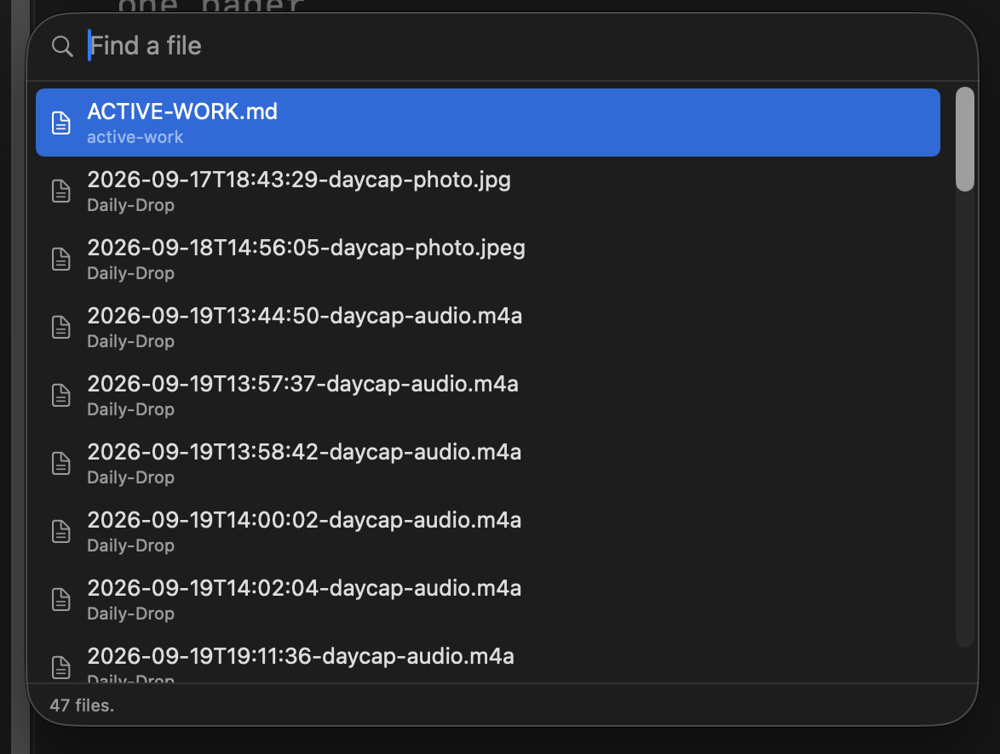

# Find File Sheet

1174 × 886 px, landscape, aspect 1.33. A cropped shot of the Find File sheet dropped
over the main window — a keyboard-driven way to reach a file without walking the
sidebar tree.

## Colors

The same near-black theme as the main window, with one loud exception.

| Role | Hex | Notes |
|---|---|---|
| Sheet background | `#1d1d1d` | 59% of the frame |
| Window behind the sheet | `#1a1a1a` | visible as a narrow strip at the left and top |
| Selected row | `#316ad6` | 5.5% of the frame — the single largest block of color |
| Primary text | `#ffffff` | filenames, query placeholder |
| Secondary text | `#8e8e8e` | the folder name under each filename |
| Icons | `#a0a0a0` | file glyphs, magnifier |
| Scrollbar thumb | `#7a7a7a` | |
| Separators / sheet edge | `#333333` hairline | rounded corners, ~14 px radius |

The blue is macOS selection blue rendered over the dark surface. Note it differs from
the system blue in the Settings panels (`#3478f6` / `#397cf7`) — this is a selection
fill, not a control tint. Apart from that one row the frame is entirely greyscale.

## Layout

The sheet is a rounded panel filling nearly the whole crop — roughly **x 22–1150
(2–98%)** and **y 10–855 (1–96.5%)** — with the dimmed parent window visible only as a
thin border. At the very top of the frame, above the sheet, a sliver of the editor
underneath shows the words `one pager` in the app's monospace, clipped by the sheet's
top edge.

Three horizontal bands, top to bottom:

1. **Search field — the top ~11%** (y 10–95). A magnifier icon at x 60–85 (5–7%), then
   the query area running the full sheet width. No visible field chrome; the row is
   separated from the list by a `#333333` hairline.
2. **Results list — the middle ~80%** (y 100–800). Nine rows, each **80 px tall
   (9% of the frame height)**, evenly spaced. Each row is laid out the same way:
   a file icon at x 58–85 (5–7%), the filename baseline at ~40% of the row height, the
   folder name beneath it. A scrollbar track sits at x 1125–1140 (96–97%); its thumb
   covers roughly the top 20% of the track, so the list is about five screens deep.
   The bottom row is clipped mid-height by the footer's edge — the list scrolls rather
   than paginates.
3. **Footer — the bottom ~9%** (y 800–855), separated by another hairline, holding a
   single left-aligned status line.

The selected row is a filled blue bar at **x 42–1102 (3.6–93.9%)**, **y 34–182 of the
list region**, 80 px tall with ~8 px rounded corners — inset from the sheet's edges by
about 3% on each side rather than running full-bleed.

## Text

**Query field.** The placeholder **Find a file** in white at ~28 px, with a blue caret
blinking before the `F`. Nothing has been typed, so the list below is unfiltered.

**Rows.** Two lines each — filename in white at ~24 px, containing folder in grey at
~17 px directly beneath:

| Filename | Folder |
|---|---|
| `ACTIVE-WORK.md` | active-work |
| `2026-09-17T18:43:29-daycap-photo.jpg` | Daily-Drop |
| `2026-09-18T14:56:05-daycap-photo.jpeg` | Daily-Drop |
| `2026-09-19T13:44:50-daycap-audio.m4a` | Daily-Drop |
| `2026-09-19T13:57:37-daycap-audio.m4a` | Daily-Drop |
| `2026-09-19T13:58:42-daycap-audio.m4a` | Daily-Drop |
| `2026-09-19T14:00:02-daycap-audio.m4a` | Daily-Drop |
| `2026-09-19T14:02:04-daycap-audio.m4a` | Daily-Drop |
| `2026-09-19T19:11:36-daycap-audio.m4a` | Daily-Drop (clipped) |

The second line is what makes the sheet usable: eight of the nine names differ only in
their timestamp, and the folder label is what tells `active-work` from `Daily-Drop`.

The ISO-8601 filenames are the longest text in the frame and still end around
x = 620 — **just over half the sheet's width** — so nothing truncates, and the right
half of the list is empty. The file types are worth noting: `.jpg`, `.jpeg` and `.m4a`
all appear, so the index covers every file in the folder, not only the plain-text ones.

**Footer.** A single line, **47 files.**, in grey at ~22 px, left-aligned at x = 58 and
occupying about 7% of the sheet's width. With an empty query that is the entire folder;
it is the line that would report how much survives a narrowing query.
