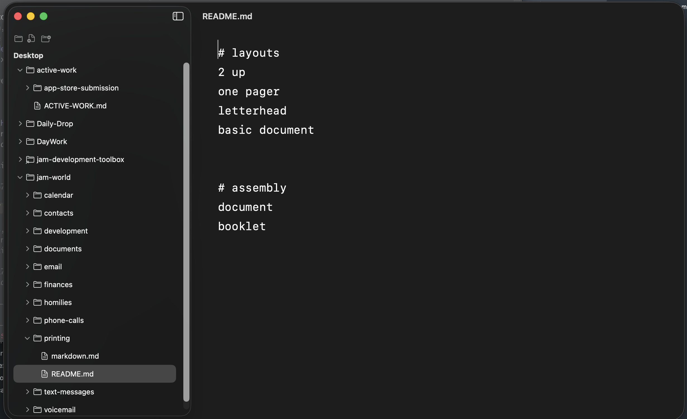

# Main Window



2462 × 1500 px, landscape, aspect 1.64. The whole app in one frame: a folder tree on
the left, one open file on the right. No tabs, no preview pane, no split view.

## Colors

A single dark theme, built out of near-blacks that sit within a few steps of each other.

| Role | Hex | Notes |
|---|---|---|
| Window / editor background | `#1d1d1d` | 71% of all pixels in the frame |
| Sidebar background | `#1c1d1d` | barely a step darker than the editor |
| Selected-row bar | `#464646` | the only large mid-grey area |
| Body text | `#ffffff` | editor text and file names |
| Secondary text / icons | `#6c6d6d`–`#9e9e9e` | disclosure triangles, folder glyphs |
| Sidebar scrollbar | `#9f9f9f` on `#262626` | |
| Window border | `#4a4a4a` hairline | over a `#3b3d3e` desktop |
| Traffic lights | `#f24a41` / `#f2ca44` / `#3cc84a` | the only saturated color anywhere |

There is **no accent color** — a scan for saturated blue pixels returns none. Selection
is signalled by lightness alone (`#1d1d1d` → `#464646`), unlike the Find File sheet and
the Settings panels, which both use system blue. The palette is flat: no gradients, no
shadows inside the window, no colored syntax highlighting on the markdown.

## Layout

The window fills the screen almost edge to edge, from x ≈ 0.5% to x ≈ 99.7%, with the
desktop showing only as a thin strip on each side (another window's text is faintly
visible behind it at both edges).

Two panes, split at **x = 683 px (27.8% of the frame)** by a one-pixel `#494949` rule:

- **Sidebar — 27.8% of the width** (x 30–657 of usable content). Contents, top to
  bottom:
  - Traffic lights at y 47–68 (3.1–4.5% down), with a sidebar-toggle icon at the far
    right of the pane, on the same line.
  - A row of three tool icons at ~9% down: open folder, new file, new folder.
  - The root label **Desktop** at ~12.5% down.
  - The tree itself, from ~16% down to the bottom edge, in rows spaced **64 px
    apart (4.3% of frame height each)**. Disclosure triangles sit at each level's
    indent; children indent roughly 22 px per level.
  - A scrollbar at x = 665 (27%), its thumb covering the upper portion of the track —
    the listing runs well past the bottom of the window.
- **Editor — the remaining 72.2%** (x 685–2451). Its text column starts at
  **x = 779 (31.6% of the frame)**, so there is a ~4% gutter between the divider and
  the first glyph. The text occupies only the left ~14% of the editor pane; the right
  ~58% of the frame is empty background. Lines are set **64 px apart**, the same rhythm
  as the sidebar rows.

The single selected row — `README.md` — is a filled bar at **y 1306–1369 (87.1–91.3%
down)**, 63 px tall (4.2% of frame height), spanning the sidebar's full width with
rounded ends.

## Text

**Sidebar.** `Desktop` as the bold root, then a mixed tree in a proportional UI face at
roughly 15 px:

```
active-work        (expanded)  app-store-submission, ACTIVE-WORK.md
Daily-Drop
DayWork
jam-development-toolbox
jam-world          (expanded)  calendar, contacts, development, documents, email,
                               finances, homilies, phone-calls,
                               printing (expanded) → markdown.md, README.md
                               text-messages, voicemail
```

Folders sort above files at every level. Every name fits its row with room to spare —
the longest, `jam-development-toolbox`, reaches x = 362, about 55% of the sidebar's
width — so nothing truncates or ellipsizes. The last entry, `voicemail`, is clipped by
the bottom window edge mid-row, confirming the list continues below the fold.

**Editor.** The filename `README.md` is printed as a plain header at y ≈ 46 (3% down),
left-aligned with the text column, in the same proportional face as the sidebar.

The document body is monospaced, white, at roughly 40 px with ~64 px leading — large
and airy. It reads:

```
# layouts
2 up
one pager
letterhead
basic document

(blank)

# assembly
document
booklet
```

The `#` characters are **visible as typed**. Nothing is rendered: no larger heading
size, no bolding, no hidden syntax. That is the point of the app — markdown is
something the printer interprets, not something the editor hides. (Compare the print
dialog's preview, where the same file's `#` marks are gone.)

The text cursor is a thin vertical bar parked at the very start of the document, before
the first `#`. The longest line, `basic document`, ends at x ≈ 915 — the document uses
about **12% of the frame's width**, leaving the editor overwhelmingly empty.
