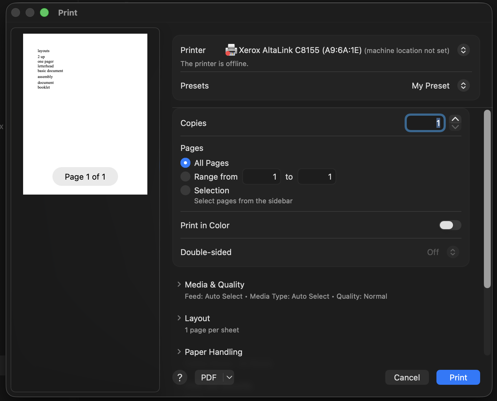

# Print Dialog



1592 × 1286 px, landscape, aspect 1.24. ⌘P has handed off to the standard macOS print
dialog. The app's own contribution is the page preview on the left — the document
already laid out by the app's print code — while the system panel on the right drives
paper, copies and destination.

## Colors

Dark system chrome with one white rectangle and one blue button.

| Role | Hex | Share of frame |
|---|---|---|
| Control cards | `#232323` | 26% |
| Dialog / left pane background | `#1d1d1d`, `#1b1b1b` | 25% + 7% |
| Page thumbnail | `#ffffff` | 8.9% |
| System blue (Print button, selected radio, focus ring) | `#3478f6` | |
| Primary label text | `#ffffff` | |
| Secondary / disabled text | `#8d8d8d` | |
| Toggle knob (off) | `#e8e8e8` on `#3a3a3a` | |
| Card / section rules | `#333333` hairlines | |

The theme is the macOS dark appearance rather than anything the app draws: raised
`#232323` cards floating on a `#1d1d1d` dialog, hairline separators inside each card,
and a single `#3478f6` default button. The printer icon is the only other color in the
frame — a small full-color Xerox glyph. The white page is a genuine paper simulation,
not a themed surface, so it reads as the brightest thing by a wide margin.

## Layout

A two-pane dialog split at **x ≈ 512 (32% of the frame)**.

**Left pane — 32% of the width**, a bordered well running the full height (y 90–1255):

- The **page thumbnail**, white, at **x 74–471 (4.6–29.6%)** and **y 108–623
  (8.4–48.4%)**. It is 397 × 515 px — a 0.77 aspect, i.e. portrait US Letter — and
  occupies about **25% of the frame's width and 40% of its height**.
- Below it, centered in the pane at y ≈ 545–590 (44%), a grey rounded pill.
- The lower half of the pane is empty, because the document is one page long.

**Right pane — the remaining 68%** (x 554–1540), a stack of cards each inset ~3% from
the dialog edge:

1. **Destination card**, y 105–320 (8–25%): Printer row, a status line, then Presets.
2. **Options card**, y 345–855 (27–66%) — the tallest at ~39% of the frame height:
   Copies, the three-way Pages group, Print in Color, Double-sided.
3. **Collapsed sections**, y 880–1160 (68–90%): three disclosure rows, each a title
   with a grey summary line beneath it. A scrollbar at x ≈ 1555 (98%) shows its thumb
   filling roughly the top two-thirds of the track — a little more sits below the fold.
4. **Button bar**, the bottom ~8% (y 1180–1240): help button at the left of the pane
   (x 555–600), then the PDF split-button, and **Cancel** / **Print** right-aligned to
   x = 1540.

Controls are right-aligned to a common edge at x ≈ 1480 (93%), labels left-aligned at
x ≈ 578 (36%), which gives the right pane a clean two-column read.

## Text

**In the preview.** The same `README.md` shown in the main-window screenshot, rendered
tiny (~7 px) in the top-left corner of the page, inside wide margins — the text block
occupies only the top 30% and left 35% of the sheet:

```
layouts
2 up
one pager
letterhead
basic document

assembly
document
booklet
```

The `#` marks are **gone**. `# layouts` and `# assembly` print as headings, set in a
heavier face and separated from the lines beneath them, while the editor showed the
literal hashes. Everything is at one size, which matches the "Print all text at the
same size" toggle being on in the Printing settings; the one-inch margins in that same
panel are visible here as the white border around the text.

Under the thumbnail, a pill reads **Page 1 of 1**.

**In the system panel**, top to bottom:

- **Printer** — `Xerox AltaLink C8155 (A9:6A:1E)` in white, followed by
  `(machine location not set)` in grey on the same line. That combined string runs from
  x 725 to x 1440, the widest text in the frame at **45% of the width**, and only just
  clears the popup's chevron.
- **The printer is offline.** in grey beneath it.
- **Presets** — `My Preset`, right-aligned. This is macOS's own preset menu, distinct
  from the app's layout presets, which live in the Printing settings tab and control
  how the page is drawn rather than how the printer is driven.
- **Copies** — `1`, in a focused field ringed in blue, with a stepper.
- **Pages** — `All Pages` selected (filled blue radio); `Range from [1] to [1]`;
  `Selection`, with the grey hint `Select pages from the sidebar` indented beneath it.
- **Print in Color** — a toggle, off.
- **Double-sided** — `Off`, the label and value both greyed out; the offline printer is
  not reporting duplex.
- **Media & Quality** — summary `Feed: Auto Select • Media Type: Auto Select •
  Quality: Normal`
- **Layout** — summary `1 page per sheet`
- **Paper Handling** — no summary line
- **PDF ⌄**, **Cancel**, **Print** in the button bar. That PDF menu is the GUI sibling
  of the shell's `electron . --pdf notes.md --out notes.pdf`: the same layout code
  reached two ways.

Section titles sit at ~24 px, values and labels at ~22 px, summary lines at ~19 px in
grey. Every string fits its row; nothing wraps or truncates.
