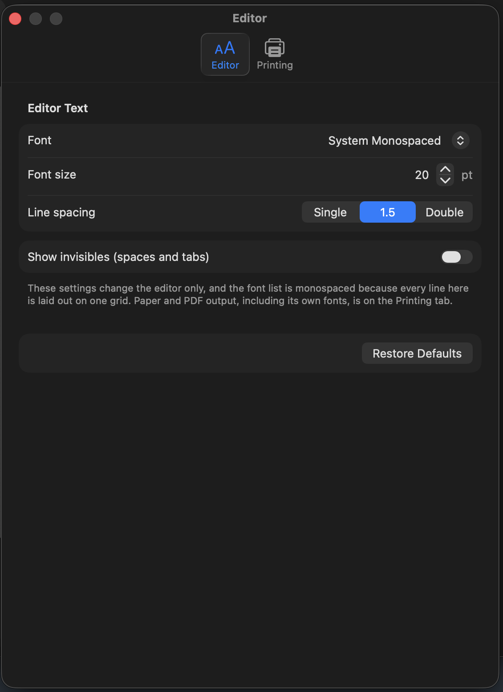

# Settings — Editor Tab

1130 × 1554 px, portrait, aspect 0.73. The same Settings window as the Printing
screenshot, with the other tab selected. This tab is deliberately short: it changes how
text looks on screen and nothing else.

## Colors

The same two-grey system as the Printing tab, but weighted very differently — the cards
cover only a fifth of the frame here, because most of the window is empty.

| Role | Hex | Share of frame |
|---|---|---|
| Window background | `#1d1d1d` | 66% |
| Card / grouped-row background | `#242424` | 18% |
| System blue (selected tab, selected segment) | `#397cf7` | |
| Segmented-control track | `#323232` | |
| Button face (Restore Defaults) | `#3a3a3a` | |
| Primary text | `#ffffff` | |
| Secondary / helper text | `#9a9a9a` | |
| Toggle knob (off) | `#e8e8e8` on `#3a3a3a` | |
| Row separators | `#333333` hairlines | |

Blue appears in exactly two places, both in the **top third** of the frame: the
selected `AA Editor` tab and the selected `1.5` segment. Their bounding box spans
x 478–932 (42–83%) and y 92–498 (6–32%) — below 32% of the height the frame is entirely
greyscale, and below 55% it is entirely empty. No scrollbar appears anywhere, unlike
the Printing tab.

## Layout

A single column with a fixed header, and a large deliberate void at the bottom.

- **Tab bar — the top 11%** (y 20–180). Traffic lights at the top left (x 20–140), a
  centered `Editor` title, then two icon-over-label tabs centered at x 455–665
  (40–59%): `AA Editor` in a `#2d2d2d` rounded well with blue icon and label, and
  `Printing` beside it in grey. A hairline closes the header.
- **Editor Text card — y 275–515 (18–33%)**, inset to **x 42–1082 (4–96%)**. Three rows
  of ~80 px (5% of frame height each), separated by hairlines: Font, Font size, Line
  spacing.
- **Show invisibles card — y 540–610 (35–39%)**, same inset, a single row.
- **Helper paragraph — y 635–690 (41–44%)**, outside any card, two lines spanning the
  full column width.
- **Restore Defaults card — y 750–835 (48–54%)**, same inset, one row with the button
  right-aligned at x 812–1060 (72–94%).
- **Empty — the bottom 46%** (y 835–1554), nothing but `#1d1d1d`.

Labels are left-aligned at x = 62 (5.5%); controls are right-aligned to x ≈ 1060 (94%).
The line-spacing segmented control is the widest control at x 705–1060, about **31% of
the width**.

## Text

**Editor Text** — three rows:

| Label | Control |
|---|---|
| `Font` | `System Monospaced` (popup) |
| `Font size` | `20` `pt` (stepper) |
| `Line spacing` | segmented: `Single` · **`1.5`** · `Double` |

`1.5` is selected and filled blue — the airy spacing seen in the main-window
screenshot, where editor lines sit 64 px apart. The three segment labels are evenly
weighted and fill their track without crowding.

**Show invisibles (spaces and tabs)** — a single row with a toggle, off. This is the
longest label in the frame, running x 62–468, about **36% of the width**, and still
leaves a wide gap before the toggle.

**Helper paragraph**, in grey, wrapping to exactly two lines:

> These settings change the editor only, and the font list is monospaced because every
> line here is laid out on one grid. Paper and PDF output, including its own fonts, is
> on the Printing tab.

It does two jobs at once: it explains why the font popup offers so little, and it sends
anyone hunting for Times New Roman one tab over.

**Restore Defaults** — a single button in its own card, resetting this tab's settings
only. Below it the panel is empty, because everything fits; on the Printing tab the
same window scrolls past a **Heading Sizes** section that never fits.
