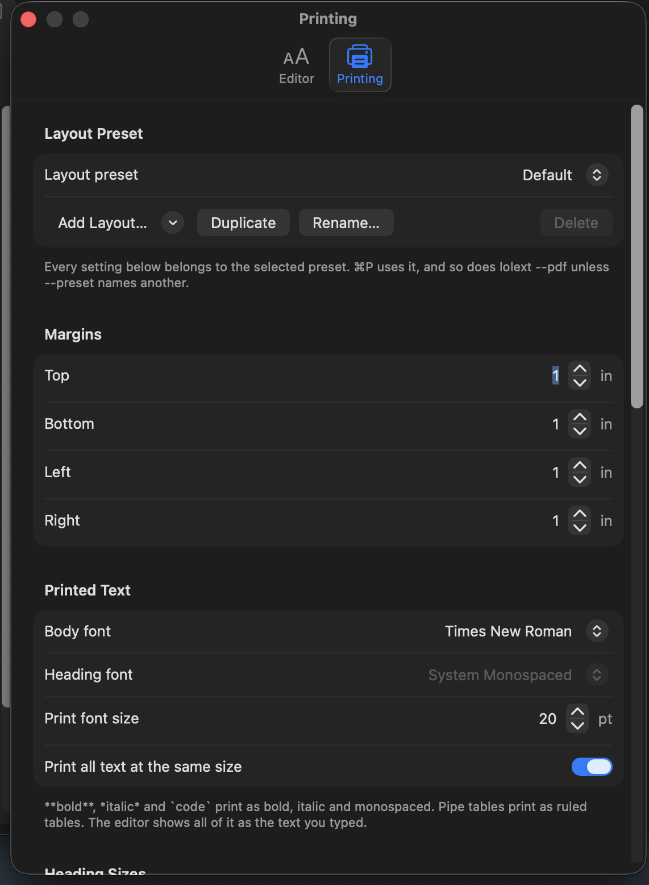

# Settings — Printing Tab

1142 × 1556 px, portrait, aspect 0.73. The Settings window on its **Printing** tab —
the panel that decides what paper and PDF output look like. Its sibling tab, Editor,
governs only what the screen looks like.

## Colors

Two greys carry the whole design, in an almost even split.

| Role | Hex | Share of frame |
|---|---|---|
| Card / grouped-row background | `#242424` | 38% |
| Window background | `#1d1d1d` | 37% |
| System blue (selected tab, focused field) | `#397bf5` / `#3d85f7` | |
| Focused-value highlight | `#476288` | the selected `1` in the Top field |
| Primary text | `#ffffff` | section headers, labels |
| Secondary / helper text | `#9a9a9a` | explanatory paragraphs, values |
| Disabled text | `#6e6e6e` | Heading font, Delete |
| Button faces | `#3a3a3a` | Duplicate, Rename…, Add Layout… |
| Scrollbar thumb | `#969696` | |

The card-versus-window contrast is only 7 levels of grey (`#242424` against `#1d1d1d`),
so grouping is conveyed by a soft edge rather than a border. Blue appears in exactly
three places: the selected `Printing` tab icon and label at the top, the blue toggle on
"Print all text at the same size," and the text selection in the focused Top margin
field. Everything else is greyscale.

## Layout

A single scrolling column, portrait, with a fixed header.

- **Tab bar — the top 11%** (y 20–175). Traffic lights at the top left (x 30–155);
  a centered window title; two icon-over-label tabs centered at x 480–690 (42–60%),
  `AA Editor` and `Printing`, the latter in a `#2d2d2d` rounded well with its icon and
  label in blue. The tabs occupy only about 18% of the width, centered.
- **Content — the remaining 89%** (y 180–1556), scrolling. Cards are inset to
  **x 58–1097 (5–96% of the width)**, leaving a 5% gutter on each side. A scrollbar
  sits at x 1110–1131 (97–99%), its thumb covering roughly the top 60% of the track.
- **Section rhythm.** Each section is a bold header at ~14 px above the card, then a
  `#242424` card of grouped rows, then optional grey helper text outside the card.
  Rows inside a card are ~85 px tall (5.5% of frame height) and separated by
  `#333333` hairlines that stop short of the card's left and right edges.
- Labels are left-aligned at x = 78 (7%); values and controls are right-aligned to
  x ≈ 1078 (94%). Units (`in`, `pt`) sit outside the steppers at the far right.

Vertical budget: Layout Preset ≈ 13% of the frame, Margins ≈ 22%, Printed Text ≈ 24%,
with the **Heading Sizes** header just breaking the bottom edge — the panel is taller
than the window.

## Text

**Layout Preset** — the top section, and the one everything else hangs off:

- Row: `Layout preset` … `Default` (popup).
- Button row: `Add Layout…` with its own chevron, `Duplicate`, `Rename…`, and
  `Delete` — greyed out, since the Default preset can't be removed. The four buttons
  span x 100–1078, filling the card's full width.
- Helper text, wrapping to two lines across the full column width:

  > Every setting below belongs to the selected preset. ⌘P uses it, and so does
  > `lolext --pdf` unless `--preset` names another.

  This is the rule the panel is built on: it is not a list of global preferences, it is
  an editor for one named preset at a time, and those same presets are what
  `--preset "Letterhead"` reaches from the shell.

**Margins** — four stepper rows, all set to `1` `in`: `Top`, `Bottom`, `Left`, `Right`.
Top is focused, its value selected against the `#476288` highlight. These are the wide
margins visible in the print preview.

**Printed Text** — four rows:

| Label | Value |
|---|---|
| `Body font` | `Times New Roman` |
| `Heading font` | `System Monospaced` (greyed out, inactive) |
| `Print font size` | `20` `pt` |
| `Print all text at the same size` | toggle, on |

The toggle being on is what disables the heading-font row above it, and is why the
print preview's headings are distinguished by weight and spacing rather than size. The
last label is the longest in the card at x 78–424, about **30% of the width**, so the
label and control columns never collide.

Helper text beneath, wrapping to two lines:

> `**bold**`, `*italic*` and `` `code` `` print as bold, italic and monospaced. Pipe
> tables print as ruled tables. The editor shows all of it as the text you typed.

**Heading Sizes** — a bold header just visible at the bottom edge, clipped mid-glyph by
the window. Its content is below the fold.
